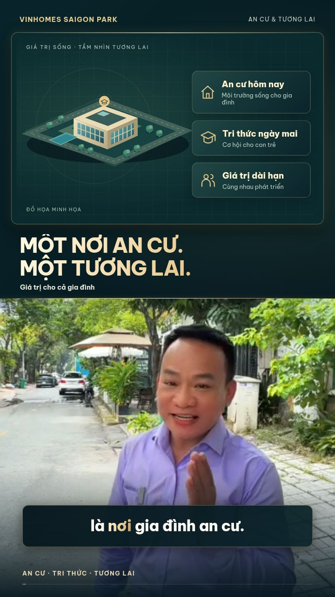

# Video BĐS — bản dựng ngày 22/10/2026

[Tải video MP4 2K](https://raw.githubusercontent.com/nguyenhuynhnguyen04-cmyk/huynhnguyen/video-family-2k-20261022/video-family-2k/video-2k.mp4)

Video dọc 1440 × 2560, 30 fps, khoảng 2 phút 6 giây. Có phụ đề tiếng Việt
trên hình, gradient champagne, glow nhẹ, chuyển cảnh mượt, cân màu và
chuẩn hóa âm lượng. Định dạng H.264/AAC MP4 hỗ trợ xem trên điện thoại và máy tính.

Bản này dùng video người nói mới ngày 22/10 cùng đồ họa minh họa BĐS theo
lời thoại. Chưa ghép bốn ảnh hiển thị trong hội thoại và các video trong
mục bộ nhớ vì môi trường dựng chưa truy cập được các tệp gốc đó.

Để xem, tải MP4 rồi mở bằng trình phát video trên thiết bị. Trên trình
duyệt máy tính, có thể nhấn chuột phải vào liên kết tải và chọn lưu liên kết.
Tệp `phu-de.vi.srt` là phụ đề rời đi kèm; phụ đề cũng đã được hiển thị sẵn
trong video. Nguồn người nói 480 × 854 được nâng kích thước khi xuất 2K.
